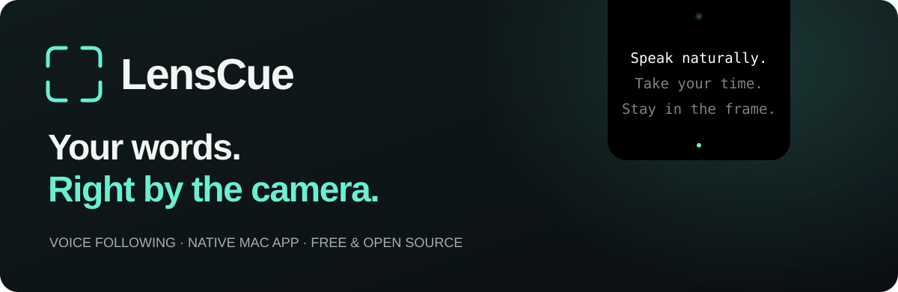
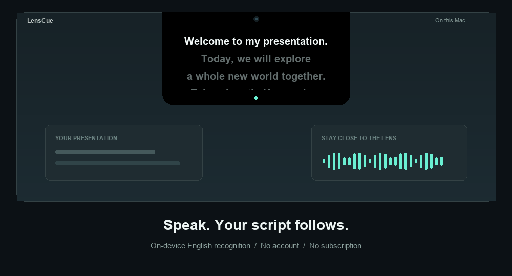
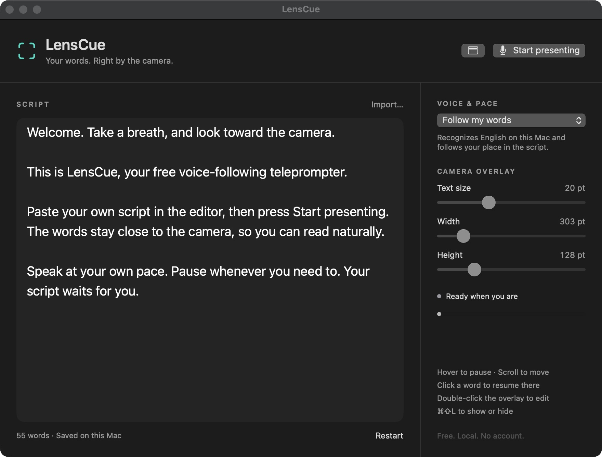

<div align="center">



**A small, voice-following teleprompter that connects to your Mac’s notch.**

Read at your own pace. Keep your notes close to the lens. Make space for a natural delivery.

[](https://github.com/ashermenachem/LensCue/releases/latest)
[](LICENSE)
[](https://github.com/ashermenachem/LensCue/actions/workflows/ci.yml)

[**Install**](#install) &nbsp; · &nbsp; [Features](#a-little-less-to-think-about) &nbsp; · &nbsp; [Controls](#controls) &nbsp; · &nbsp; [Build](#build-it-yourself) &nbsp; · &nbsp; [Discussions](https://github.com/ashermenachem/LensCue/discussions) &nbsp; · &nbsp; [Roadmap](docs/ROADMAP.md)

<br />



<sub>Animated walkthrough of the voice-following interaction. See the actual editor below.</sub>

</div>

## A little less to think about

Your script should keep up with you. LensCue places a compact black panel against the top edge of your display, visually joining the camera notch. The reading line sits just **6 points below the cutout**. No floating toolbar. No account to create. No subscription to unlock.

| | Built for a focused delivery |
| :--- | :--- |
| **Follow your words** | On-device English speech recognition keeps your place in the script. Read text dims as you go. |
| **Pause naturally** | Stop speaking and the script waits. Hover over the overlay whenever you want a moment. |
| **Stay close to the camera** | A notch-connected panel with adjustable width, height and text size. Prefers the notched display when one is connected. |
| **Choose your rhythm** | Word following, sound-triggered scrolling, or steady auto-scroll. |
| **Find your place** | Scroll manually or click a word to continue from there. |
| **Keep it local** | Scripts and settings stay on your Mac. Audio is not saved. No analytics or paid APIs. |

<details>
<summary><strong>See the actual editor</strong></summary>
<br />

</details>

## Install

**You’ll need:** an Apple silicon Mac (M1 or newer), running macOS 14 Sonoma or later. A notch is optional; the overlay also works at the top center of a display without one.

1. **[Download the latest release](https://github.com/ashermenachem/LensCue/releases/latest)** and choose `LensCue-macOS-AppleSilicon.zip` under **Assets**.
2. **Double-click the ZIP** to unzip it, then drag **LensCue.app** into **Applications**.
3. **Open LensCue.** Paste your script into the editor.
4. Click **Start presenting**. Allow **Microphone** and **Speech Recognition** when macOS asks. Look toward the camera and start reading.

> **First launch:** this community build is locally signed, but **not Apple-notarized**. macOS may block the first launch. After trying to open it, go to **System Settings → Privacy & Security → Open Anyway** for LensCue, then confirm **Open**. Only do this for a download you trust. If you prefer, [build directly from the source](#build-it-yourself). You do not need to disable Gatekeeper or run a quarantine-removal command.

**That’s it.** Your script and display preferences are saved automatically. The menu bar icon brings back the editor and playback controls.

Need help? See the **[installation & troubleshooting guide](docs/INSTALL.md)**.

## Three ways to read

| Mode | How it moves | Microphone |
| :--- | :--- | :--- |
| **Follow my words** | Matches what you say to the written English script. Pauses as you pause. | On-device speech recognition |
| **Voice activity** | Scrolls at your chosen speed while sound is detected. Stops on silence. | Sound level only |
| **Auto-scroll** | Scrolls continuously at your chosen speed. | Not used |

Word following works best when you read reasonably close to the script. After a large skip or some ad-libbing, click the word you want to resume from. Other voices or background noise can trigger **Voice activity**; adjust its microphone threshold before starting.

## Controls

| Action | Control |
| :--- | :--- |
| Start / pause | Editor button or menu bar icon |
| Start / pause from the editor | `⌘ Return` |
| Show / hide the overlay | `⌘ ⇧ L` or menu bar icon |
| Reopen the editor | Double-click the overlay, or `⌘ E` while LensCue is active |
| Temporarily pause | Hover over the overlay |
| Move through the script | Scroll over the overlay |
| Resume at a specific word | Click the word in the overlay |
| Restart | Editor button, menu bar icon, or `⌘ 0` while LensCue is active |
| Quit | `⌘ Q` while LensCue is active |

Global shortcuts can depend on macOS input-monitoring permissions. The menu bar controls remain available.

## Private by design

- **Your script stays local.** Stored in macOS app preferences, with your display settings.
- **Audio is never saved by LensCue.** Microphone access stops when you pause or finish presenting.
- **Word recognition requires on-device support.** The app checks for it and does not fall back to a cloud recognizer. Apple’s English speech model must be available on the Mac.
- **No accounts, telemetry, ads, or backend.** Read the [privacy notes](docs/PRIVACY.md) or inspect the code.

## Build it yourself

Install **Xcode 16 or newer** with a **Swift 6 toolchain**, then:

```bash
git clone https://github.com/ashermenachem/LensCue.git
cd LensCue
swift test
./script/build_and_run.sh
```

The script builds, locally signs, and opens `dist/LensCue.app`. Drag that app to **Applications** if you want to keep it there. No third-party Swift dependencies or API keys are required. The current downloadable build is Apple silicon; Intel users can try building the source locally (not yet validated on Intel hardware).

<details>
<summary><strong>Build commands & project layout</strong></summary>

```bash
./script/build_and_run.sh --build    # Build an app without opening it
./script/build_and_run.sh --verify   # Build, open, check the process
./script/build_and_run.sh --package  # Optimized app + ZIP + SHA-256 checksum
./script/build_and_run.sh --debug    # Launch with LLDB
./script/build_and_run.sh --logs     # Launch and stream app logs
```

```text
Sources/
  CueCore/       Word matching and voice/silence gating
  LensCue/       Native app, microphone, overlay and script editor
Tests/           Focused tests for tracking and voice gating
script/          Reproducible app build and packaging
docs/            Installation, privacy, roadmap and visual assets
.github/         CI, issue forms and contribution templates
```

</details>

## What to expect

LensCue is a small **v1.0** app. Word following is currently **English-only**. Camera placement helps keep your gaze near the lens, but cannot guarantee invisible reading. The overlay is **not guaranteed hidden from screen recordings or screen sharing**; share a specific app window when appropriate. The release is **not notarized**.

Validation includes five automated tests covering partial transcripts, recognition revisions, seeking, unrelated speech, Unicode/empty scripts, and voice/silence gating. A synthesized English audio fixture was recognized on device and aligned **21/21 words**. Real-world accuracy depends on the speaker, microphone and environment.

## Make it better

Ideas and contributions are welcome. Start with the [roadmap](docs/ROADMAP.md), open a [bug report](https://github.com/ashermenachem/LensCue/issues/new/choose), or bring an idea to [Discussions](https://github.com/ashermenachem/LensCue/discussions).

Read [CONTRIBUTING.md](CONTRIBUTING.md) before submitting a pull request. The goal is to keep LensCue simple, fast and useful.

---

<div align="center">

**Free to use. Free to study. Free to change.**

Built by [Asher Menachem](https://github.com/ashermenachem) · [MIT licensed](LICENSE)

<sub>Independently implemented. Inspired by the camera-adjacent teleprompter idea; no Notchie code or paid assets included.</sub>

</div>
